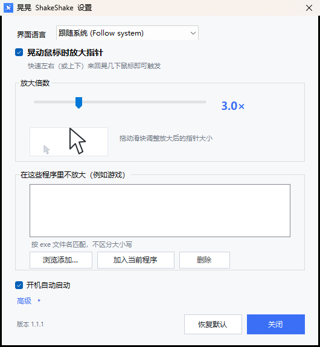
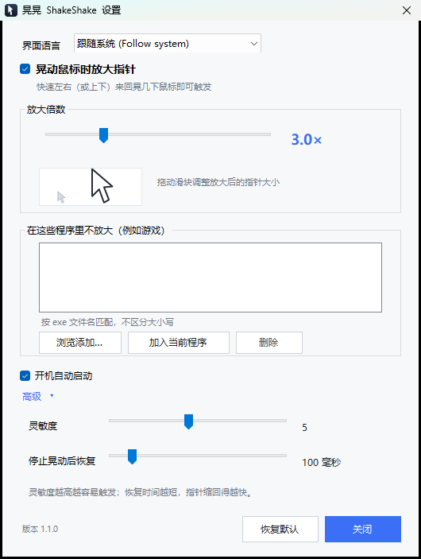
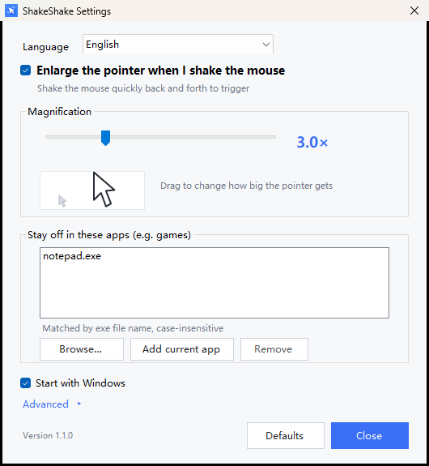

# 晃晃 ShakeShake

Windows 上的「晃动鼠标放大指针」小工具（类似 macOS 的 shake to find cursor）。

快速来回晃动鼠标 → 系统光标临时放大（默认 3×）→ 停止晃动约 100ms 后恢复。

- 绿色单文件 exe（约 90 KB），无需安装、无需管理员权限、不依赖任何运行库
- 中文 / English 双语界面，可选「跟随系统」
- 可自定义放大倍数、灵敏度、恢复延迟
- 可指定某些程序（如游戏）内不生效
- 开机自启、全局快捷键（Ctrl+Alt+S）暂停/恢复

## 下载

到 [Releases](../../releases/latest) 下载 **`ShakeShake-x64.exe`**，双击即用——绿色单文件，
不需要安装，也不需要 .NET SDK。同一个 Release 里还有 `ShakeShake-Manual.txt`（中文使用说明）。

> 首次运行时 Windows SmartScreen 可能提示"未知发布者"，点「更多信息」→「仍要运行」即可。
> 这是未签名程序的正常提示；源码全部公开，可自行编译核对。

用户文档见 [`dist/使用说明.txt`](dist/使用说明.txt)。

## 截图

| 中文主界面 | 高级设置 | English |
| --- | --- | --- |
|  |  |  |

## 构建

需要 Windows 自带的 .NET Framework 4.8（Win10/11 默认就有），**不需要装 .NET SDK**。

```powershell
powershell -ExecutionPolicy Bypass -File .\build.ps1          # 只编译
powershell -ExecutionPolicy Bypass -File .\build.ps1 -Tests   # 编译 + 跑检测算法单元测试
```

产物：`dist\ShakeShake.exe`（64 位，编译时带 `/platform:x64`）。

源码是 **C# 5**（系统自带 `csc.exe` 只支持到 C# 5），所以代码里不要用字符串插值、`?.`、`nameof` 等新语法。
编译时必须带 `/codepage:65001`（源码是 UTF-8），否则中文会乱码。

## 测试

```powershell
tests\DetectorTests.exe          # 晃动检测算法（10 个用例）
dist\ShakeShake.exe --selftest   # 端到端：装钩子、注入真实鼠标晃动、验证指针变大再恢复
dist\ShakeShake.exe --animtest   # 采样动画：验证尺寸是一帧帧渐变，而不是一次跳变
```

`--selftest` 会短暂移动鼠标并把指针放大到 3×，约 3 秒，结束后自动还原；结果写入
`%TEMP%\shakeshake-selftest.log`，退出码 0 = 通过。

## 结构

```
src/
  Program.cs          入口、单实例、DPI、全局异常
  TrayApp.cs          托盘、菜单、快捷键、生命周期
  SettingsForm.cs     设置窗口（全部控件 + 双语切换）
  AppController.cs    钩子 → 检测 → 放大/恢复 的状态机
  ShakeDetector.cs    纯算法：方向反转计数（可单测）
  MouseHook.cs        WH_MOUSE_LL 全局低级鼠标钩子
  CursorEngine.cs     SetSystemCursor 放大 / SPI_SETCURSORS 还原 / 崩溃自愈
  Settings.cs         settings.ini 读写
  Localization.cs     中英文字符串表
  AutoStart.cs        HKCU\...\Run
  Hotkey.cs           快捷键解析
  ProcInfo.cs         前台进程名（排除列表用）
  Native.cs           Win32 声明
  Log.cs / SelfTest.cs
assets/
  make_icon.py        用 Pillow 生成多尺寸 app.ico
  app.ico
tests/
  DetectorTests.cs    晃动检测算法单测（10 个用例）
  UiLayoutTests.cs    设置窗口布局回归（展开/收起/中英文）
```

## 实现要点

1. **放大**：读 `HKCU\Control Panel\Cursors` 里当前鼠标方案的光标文件（`aero_arrow.cur` 等），
   用 `LoadImage` 按目标像素尺寸加载（这些 .cur 里本身就带 32/48/64/96/128 多档），
   再对每个 `OCR_*` 调 `SetSystemCursor` 换掉系统光标；发一条 `WM_SETCURSOR`
   让指针下的窗口立刻重设光标，所以是“瞬间变大”而不是等下次移动。
2. **还原**：`SystemParametersInfo(SPI_SETCURSORS)` 重新加载用户的鼠标方案。
3. **动画**：控制器每 15ms 向目标尺寸逼近一帧（指数缓动 `0.38`，单帧最多 16px），
   32→96 大约 8～10 帧、约 130ms；缩回同理。动画跑在定时器线程，钩子回调只做判定，
   所以鼠标移动不会被卡住；晃动中途停止/再晃会在当前尺寸上平滑反向。
4. **防残留**：放大前写 `enlarged.marker`，还原后删除；启动时若发现标记就强制还原。
   退出、未处理异常、`AppDomain.ProcessExit` 都会尝试还原。
5. **为什么不用系统「指针大小」设置**：Windows 11（本机 build 28000）上，
   改 `CursorBaseSize` / `CursorSize` 后 `SPI_SETCURSORSIZE` 不会即时生效（实测），
   而 `SetSystemCursor` 是可靠的。

## 已知限制

- 独占全屏 / 自己 `SetCursor` 画光标的游戏看不到效果（系统光标本来也不显示）→ 用排除名单。
- UAC 安全桌面、锁屏界面钩子收不到、也改不了（系统限制）。
- 若系统光标方案里某些光标是 `.ani` 动画或路径为空（如 IBeam、Crosshair），会跳过，保持原样。

## 参与贡献

欢迎提 Issue / PR。提交前请先跑一遍 `build.ps1 -Tests`，保证编译和 14 个用例全部通过；
改动源码时注意保持 **C# 5 语法**和 UTF-8 编码（见上文「构建」）。

## 许可证

本项目采用 [MIT 许可证](LICENSE)，可自由使用、修改、分发，包括商业用途。
