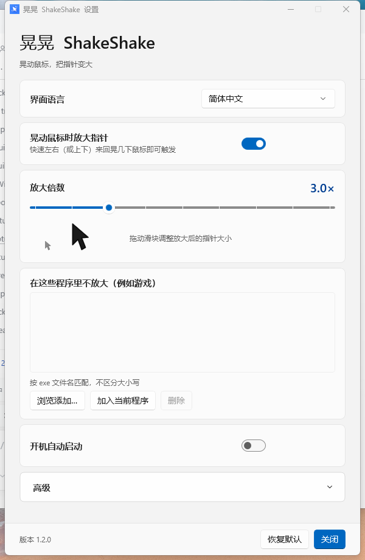
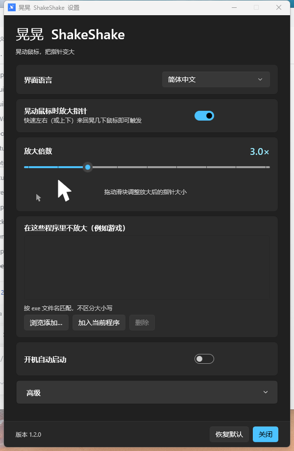
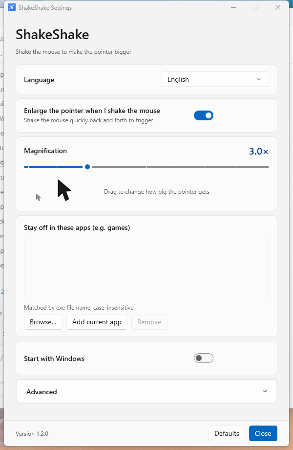
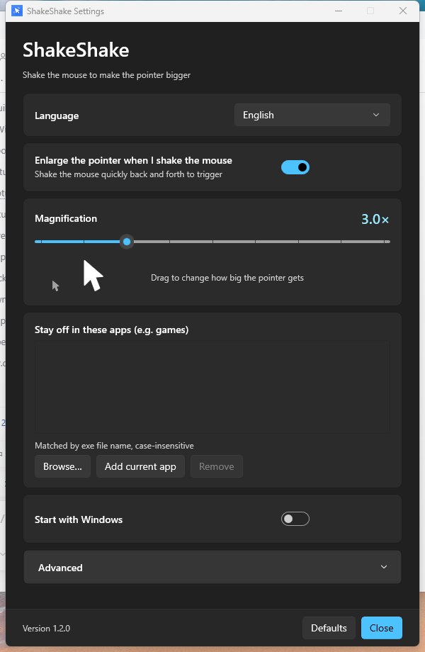
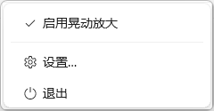
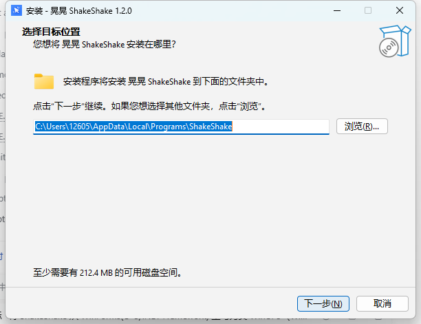
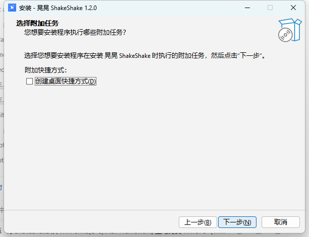

# 晃晃 ShakeShake

> 🤖 本项目由 AI 开发。

Windows 上的「晃动鼠标放大指针」小工具（类似 macOS 的 shake to find cursor）。

快速来回晃动鼠标 → 系统光标临时放大（默认 3×）→ 停止晃动约 100ms 后恢复。

- **原生 WinUI 3 界面**（Windows App SDK / Fluent Design）：圆角卡片、开关、Mica 背景，
  跟随系统浅色 / 深色模式和强调色
- **安装包形式**，安装向导可自定义安装路径；默认按当前用户安装，无需管理员权限
- 安装包自带 .NET 8 与 Windows App Runtime（自包含），目标机器不用装任何运行库
- 中文 / English 双语界面，可选「跟随系统」
- 可自定义放大倍数、灵敏度、恢复延迟
- 可指定某些程序（如游戏）内不生效
- 开机自启、全局快捷键（Ctrl+Alt+S）暂停/恢复、Fluent 托盘菜单

## 下载

到 [Releases](../../releases/latest) 下载 **`ShakeShake-1.2.0-Setup.exe`**（安装版）。
安装时可以选择安装目录；装完从开始菜单或托盘运行。

> 首次运行时 Windows SmartScreen 可能提示"未知发布者"，点「更多信息」→「仍要运行」即可。
> 这是未签名程序的正常提示；源码全部公开，可自行编译核对。

用户文档见 [`dist/使用说明.txt`](dist/使用说明.txt)。

## 截图

| 中文主界面（浅色） | 高级设置 | 深色模式 |
| --- | --- | --- |
|  |  |  |

| English | English (dark) | 托盘菜单 |
| --- | --- | --- |
|  |  |  |

安装包（安装向导可自定义安装位置）：

| 安装向导 | 选择目标位置 |
| --- | --- |
|  |  |

## 构建

需要 **.NET 8 SDK**（构建机用；运行机器不需要）和 **Inno Setup 7**（只有打安装包时需要）。
不需要 Visual Studio。

```powershell
powershell -ExecutionPolicy Bypass -File .\build.ps1                    # 只编译
powershell -ExecutionPolicy Bypass -File .\build.ps1 -Tests             # 编译 + 跑单元测试
powershell -ExecutionPolicy Bypass -File .\build.ps1 -Tests -Installer  # 编译 + 测试 + 安装包
```

产物：

- `dist\app\` — 自包含程序目录（可直接运行 `dist\app\ShakeShake.exe`）
- `dist\ShakeShake-<版本>-Setup.exe` — 安装包（`-Installer` 才会生成）

`build.ps1` 会优先使用 `%USERPROFILE%\.dotnet\dotnet.exe`，找不到时回退到 PATH 里的 `dotnet`。
安装包编译器默认在 `%LOCALAPPDATA%\Programs\Inno Setup 7\ISCC.exe` 等常见位置查找，
也可以用 `-Iscc <路径>` 指定。

源码是 C#（.NET 8，`LangVersion=latest`）。界面是 XAML（WinUI 3），改动界面在 `src/ShakeShake.App`。

## 测试

```powershell
dotnet run --project tests\ShakeShake.Tests     # 晃动检测算法（10 个用例）
dist\app\ShakeShake.exe --selftest              # 端到端：装钩子、注入真实鼠标晃动、验证指针变大再恢复
dist\app\ShakeShake.exe --animtest              # 采样动画：验证尺寸是一帧帧渐变，而不是一次跳变
```

`--selftest` 会短暂移动鼠标并把指针放大到 3×，约 3 秒，结束后自动还原；结果写入
`%TEMP%\shakeshake-selftest.log`，退出码 0 = 通过。

重新生成 README 里的截图（需要先编译 Debug 版本）：

```powershell
powershell -ExecutionPolicy Bypass -File .\tools\capture-ui.ps1
```

## 结构

```
src/
  ShakeShake.Core/     纯逻辑，不依赖 UI：晃动检测、光标放大引擎、全局鼠标钩子、
                       设置读写、开机自启、快捷键解析、前台进程识别
  ShakeShake.App/      WinUI 3 程序：XAML 界面、托盘图标与 Fluent 菜单、单实例、
                       ContentDialog 提示、--selftest / --animtest
tests/
  ShakeShake.Tests/    晃动检测算法单测（10 个用例）
installer/
  ShakeShake.iss       Inno Setup 安装脚本（per-user、自定义路径、中英双语）
tools/
  capture-ui.ps1       自动截取各主题 / 语言下的界面截图
assets/
  icon_master.png      图标母版（1254×1254 原图，改图标只改这里）
  make_icon.py         用 Pillow 从 icon_master.png 生成 app.ico 和灰化的 tray_off.ico
  app.ico              多尺寸图标（16～256 共 9 档），构建时嵌进 exe
  tray_off.ico         暂停状态的灰色托盘图标（由 make_icon.py 生成）
```

## 图标

图标母版只有 `assets\icon_master.png` 一个文件，换图标就是换它（或运行时直接传入新图）：

```powershell
python .\assets\make_icon.py                 # 用当前 icon_master.png 重新生成 app.ico + tray_off.ico
python .\assets\make_icon.py .\new-icon.png  # 换成新图并重新生成
```

## 实现要点

1. **放大**：读 `HKCU\Control Panel\Cursors` 里当前鼠标方案的光标文件（`aero_arrow.cur` 等），
   用 `LoadImage` 按目标像素尺寸加载（这些 .cur 里本身就带 32/48/64/96/128 多档），
   再对每个 `OCR_*` 调 `SetSystemCursor` 换掉系统光标；发一条 `WM_SETCURSOR`
   让指针下的窗口立刻重设光标，所以是“瞬间变大”而不是等下次移动。
2. **还原**：`SystemParametersInfo(SPI_SETCURSORS)` 重新加载用户的鼠标方案。
3. **动画**：控制器每 15ms 向目标尺寸逼近一帧（指数缓动 `0.38`，单帧最多 16px），
   32→96 大约 8～10 帧、约 130ms；缩回同理。动画跑在定时器线程，钩子回调只做判定，
   所以鼠标移动不会被卡住；晃动中途停止/再晃会在当前尺寸上平滑反向。
4. **防残留**：放大前写 `enlarged.marker`，还原后删除；启动时若发现标记就强制还原。
   退出、未处理异常、`AppDomain.ProcessExit` 都会尝试还原。
5. **为什么不用系统「指针大小」设置**：Windows 11（本机 build 28000）上，
   改 `CursorBaseSize` / `CursorSize` 后 `SPI_SETCURSORSIZE` 不会即时生效（实测），
   而 `SetSystemCursor` 是可靠的。
6. **界面**：WinUI 3（Windows App SDK）原生控件 —— `ToggleSwitch`、`Slider`、
   `ComboBox`、`ListView`、`Expander`、`ContentDialog`；`MicaBackdrop` 做背景，
   深浅色 / 强调色都交给系统主题资源，不写死颜色。
7. **托盘**：WinUI 3 没有内置托盘组件，`TrayIcon` 用 `Shell_NotifyIcon`
   加一个消息窗口，菜单是一个无边框的 WinUI 弹窗（`TrayMenuWindow`），
   所以外观和系统菜单一致（含勾选状态、深色模式）。
8. **安装包**：Inno Setup 7，`PrivilegesRequired=lowest` 按用户安装，
   默认目录 `%LOCALAPPDATA%\Programs\ShakeShake`，向导的「选择目标位置」页可自定义；
   程序为自包含发布，安装目录里带齐运行库。

## 已知限制

- 独占全屏 / 自己 `SetCursor` 画光标的游戏看不到效果（系统光标本来也不显示）→ 用排除名单。
- UAC 安全桌面、锁屏界面钩子收不到、也改不了（系统限制）。
- 若系统光标方案里某些光标是 `.ani` 动画或路径为空（如 IBeam、Crosshair），会跳过，保持原样。
- Windows 10 上没有 Mica 背景（自动回退成纯色），其余功能与 Win11 一致。
- 安装包约 56 MB：WinUI 3 的自包含发布把 .NET 8 和 Windows App Runtime 都打包进去了；
  这样做的好处是目标机器不用任何运行库、离线可用。

## 参与贡献

欢迎提 Issue / PR。提交前请先跑一遍 `build.ps1 -Tests`，保证编译和 10 个用例全部通过；
改动源码时注意保持 UTF-8 编码。

## 许可证

本项目采用 [MIT 许可证](LICENSE)，可自由使用、修改、分发，包括商业用途。
